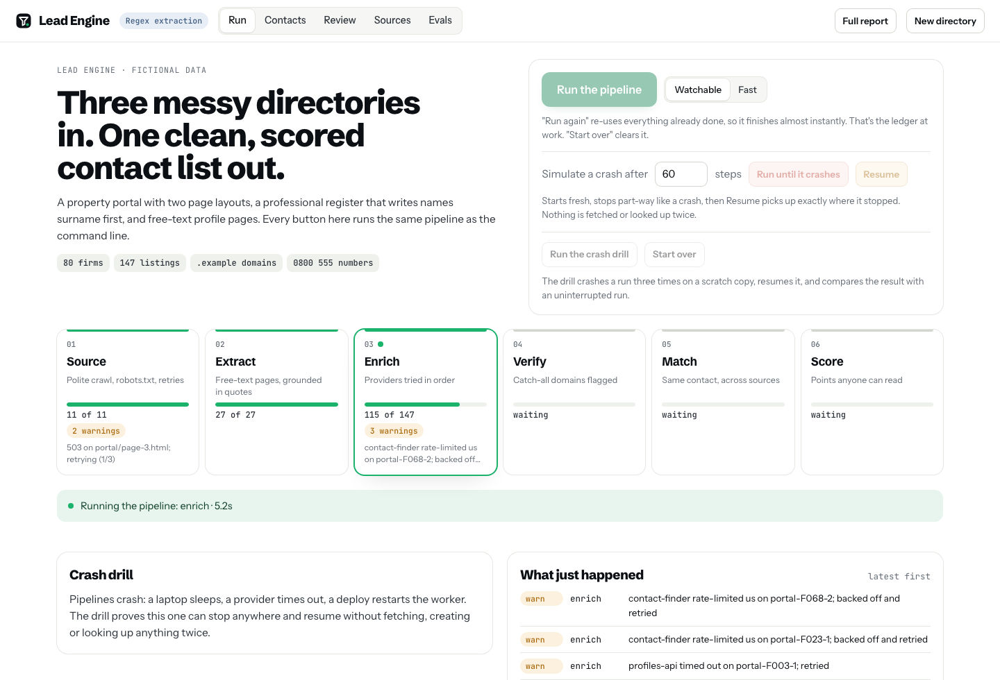
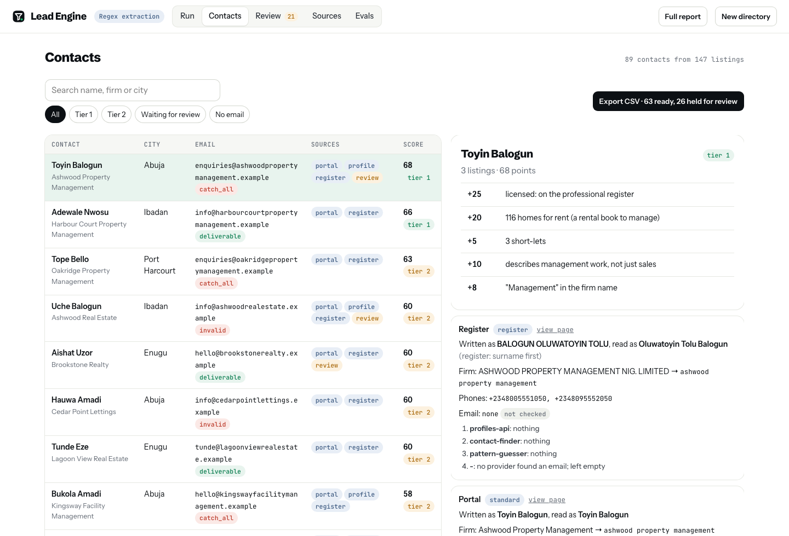
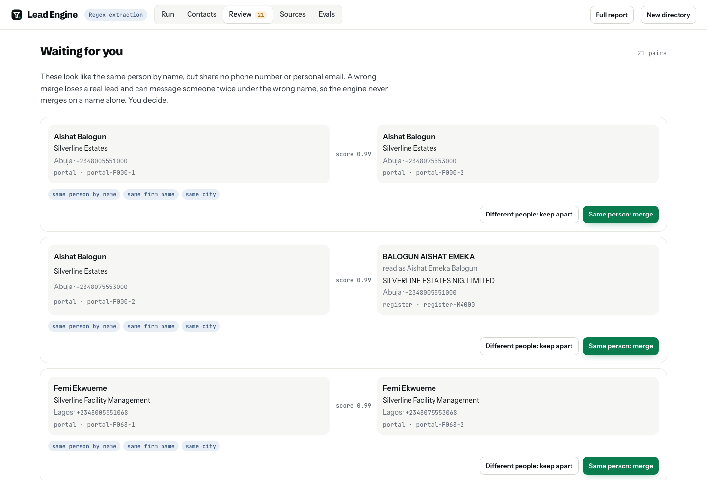

# Lead Engine

[](https://github.com/AbiodunOlaoluwa/lead-engine/actions/workflows/test.yml)

Turns messy public directories into a clean, de-duplicated, scored list of business contacts. It extracts with an LLM where pages are free text, keeps only what it can ground in the page, and is measured with evals.

This is a rebuild, on generated fictional data, of the pipeline that sourced Rentyx's sales list: 11,000+ contacts from Nigerian property portals and professional registers. Every rule in it came from something that went wrong on the real data.



## Try it

```bash
uv sync --extra llm --group dev
uv run python -m lead_engine serve        # http://127.0.0.1:8040
```

Every command is a button: run the pipeline (watchable or fast), crash it at a chosen step and resume, run the crash drill, decide the review queue, export the contacts, open the raw directory pages, and run the evals. Progress is pushed from the engine as it works (server-sent events), so a stage only turns green when the engine says it finished, and warnings appear on the stage that hit them.

| Contacts, with each one's full trail | Review queue: the engine never merges on a name alone |
| --- | --- |
|  |  |

## The pipeline

| Stage | What it does | What it protects against |
| --- | --- | --- |
| **Source** | Polite crawl: reads robots.txt, honours the crawl delay, retries with backoff | Getting blocked; losing a page to one 503 |
| **Parse** | Two portal layouts and a register table; every page records listings *shown* versus *kept* | A parser that silently skips a layout (the real one dropped half of every page) |
| **Extract** | Free-text profile pages read by Claude or a regex baseline, through the same grounding check | Invented contact details: every field must quote the page, or it's dropped |
| **Enrich** | Three providers in order, each with a recorded result | Guessing: if nobody finds an email, the field stays empty |
| **Verify** | Every address checked; catch-all domains flagged and quarantined | "Verified" addresses that bounce later |
| **Match** | Shared phone or personal email links automatically; similar names go to review | Wrong merges, and the same person messaged twice under two numbers |
| **Score** | Points anyone can read, per contact rather than per listing | "Why is this lead at the top?" having no answer |

Every stage writes to a ledger as it finishes each record. Stop the run anywhere and start it again: nothing is fetched, created or looked up twice. `python -m lead_engine drill` proves it by stopping three times and comparing the result with an uninterrupted run.

## Evals

`python -m lead_engine eval` regenerates the directory, runs the whole pipeline, and scores it against the truth file, plus hand-written hard cases. Current results:

**Matching, end to end** (147 listings, 80 real contacts)

| Measure | Result |
| --- | --- |
| Automatic links: precision | **100%** (0 wrong merges) |
| Automatic links: recall | 83% |
| Sent to review: share that really were the same | 86% |
| True duplicates surfaced (linked or sent to review) | **100%** |

**Extraction** (precision / recall)

| Extractor | Set | Name | Phones | Emails |
| --- | --- | --- | --- | --- |
| regex baseline | generated profiles (27) | 100% / 100% | 100% / 100% | 100% / 100% |
| regex baseline | hard cases (10) | 100% / 43% | 100% / 100% | 100% / 100% |

The hard cases are where the baseline breaks: initials only, "office manager, Ifeoma Nnadi", a founder versus the current lead, a building that looks like a name. To add Claude's row, run the same command with `LEAD_ENGINE_MODE=anthropic` and an API key. Grounding applies to both extractors, so a higher-recall model can't buy recall with invented fields.

**Name matching traps** (24 pairs): 94% precision, 100% recall. The one miss is reported, not hidden: Damilola and Damilare are different names that both shorten to "Dami".

## Why the rules exist

- **Surname-first registers.** "ADEYEMI FUNMILAYO OLUWASEUN" read as written greets the wrong name. Registers are parsed surname first.
- **Short forms.** Funmi is Olufunmilayo, Toyin is Oluwatoyin, Emeka is Chukwuemeka. Matching on exact names missed a contact who was already in a conversation, and they were messaged again under a second number.
- **Role mailboxes don't identify people.** Two firms with the same name share a guessed `info@` address, so role addresses never link contacts.
- **Catch-all domains.** They accept every address and bounce later. One flagged address quarantines its domain.
- **Common surnames prove nothing alone.** "Amadi Amadi" and "Chinedu Amadi" stay apart.

## Command line

```bash
uv run python -m lead_engine generate   # the fictional directory, in data/site
uv run python -m lead_engine run        # resumable; add --stop-after N to simulate a crash
uv run python -m lead_engine drill      # crash three times, resume, compare with a clean run
uv run python -m lead_engine report     # out/report.html
uv run python -m lead_engine eval       # evals/results.md
uv run python -m lead_engine serve      # the demo app
uv run pytest
```

There is also a static report of the latest run: `uv run python -m lead_engine report`, then open `out/report.html`.

| Variable | Default | Purpose |
| --- | --- | --- |
| `LEAD_ENGINE_MODE` | regex baseline | `anthropic` to extract with Claude |
| `LEAD_ENGINE_MODEL` | `claude-opus-5` | Any current Claude model id |

Claude calls use a JSON schema, low effort, a cached system prompt, and Anthropic's server-side refusal fallback. Token use and cost are recorded per call.

All firms, people, phone numbers (an unassigned 0800 555 range) and `.example` domains are fictional.

Built by [Olaoluwa Abiodun](https://github.com/AbiodunOlaoluwa).
